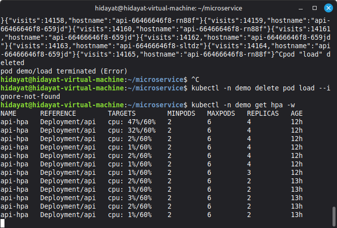
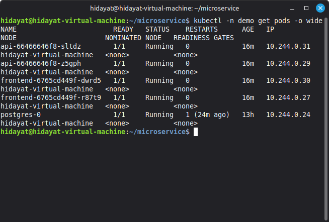
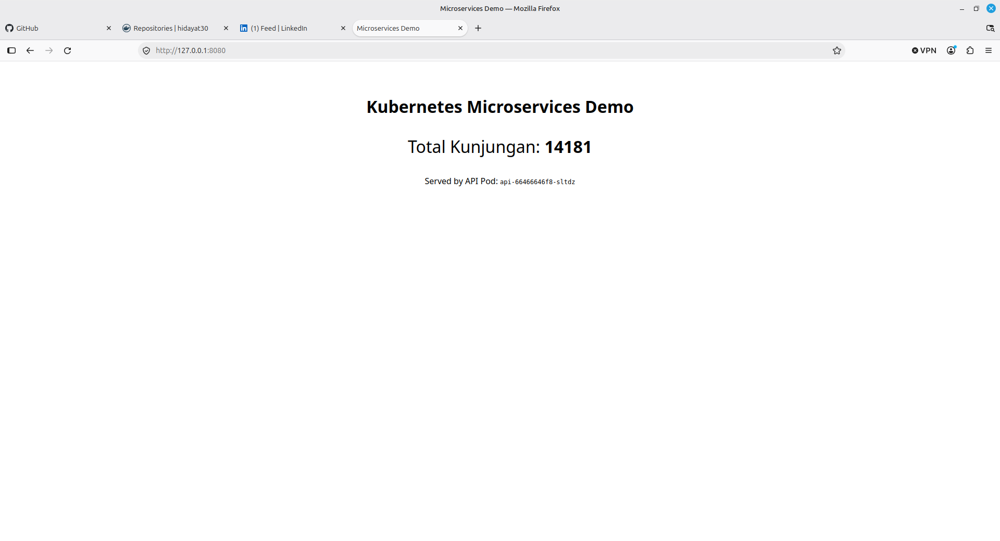

[](https://hub.docker.com/r/hidayat30/api)
[](https://hub.docker.com/r/hidayat30/api)
[](https://hub.docker.com/r/hidayat30/frontend)
[](https://hub.docker.com/r/hidayat30/frontend)

# microservice
3-tier microservices demo on Kubernetes (React + Node.js + PostgreSQL) with Ingress, HPA, and zero-downtime rolling updates.

## Architecture

Request flow: User → Ingress (demo.local) → frontend (nginx) → api (Node.js) → postgres (StatefulSet).

| Component | Kubernetes Resource | Function |
|---|---|---|
| frontend | Deployment (2 replicas) + Service | React UI, served by nginx |
| api | Deployment (2 replicas, HPA 2-6) + Service | REST API, inserts and counts visits |
| postgres | StatefulSet + PVC 1Gi + Secret | Stores visit data |
| ingress | Ingress-NGINX | Routes / → frontend, /api → api |
| hpa | HorizontalPodAutoscaler | Automatically scales api based on CPU |

## Kubernetes Microservices Demo (kubeadm v1.32 + Flannel CNI)

## 1. Build & Push / Import Image

Replace `YOUR_DOCKERHUB` with your DockerHub account in `k8s/02-api.yaml` and `k8s/03-frontend.yaml`:

```bash
export REGISTRY=hidayat30

docker build -t $REGISTRY/api:1.0 ./api
docker build -t $REGISTRY/frontend:1.0 ./frontend

# Option A: Push to DockerHub
docker push $REGISTRY/api:1.0
docker push $REGISTRY/frontend:1.0

# Option B: Import directly into local containerd (single-node, no push)
docker save $REGISTRY/api:1.0 | sudo ctr -n k8s.io images import -
docker save $REGISTRY/frontend:1.0 | sudo ctr -n k8s.io images import -
```

## 2. Install Ingress-NGINX & Metrics Server

### Ingress-NGINX (Bare-metal / NodePort)
```bash
kubectl apply -f https://raw.githubusercontent.com/kubernetes/ingress-nginx/controller-v1.12.0/deploy/static/provider/baremetal/deploy.yaml
kubectl wait --namespace ingress-nginx \
  --for=condition=ready pod \
  --selector=app.kubernetes.io/component=controller \
  --timeout=120s
```

### Metrics Server (with the `--kubelet-insecure-tls` patch)
```bash
kubectl apply -f https://github.com/kubernetes-sigs/metrics-server/releases/latest/download/components.yaml

kubectl patch deployment metrics-server -n kube-system \
  --type='json' \
  -p='[{"op": "add", "path": "/spec/template/spec/containers/0/args/-", "value": "--kubelet-insecure-tls"}]'
```

## 3. Apply Kubernetes Manifests

Before applying the manifests, replace `REPLACE_WITH_A_SECURE_PASSWORD` in
`k8s/01-postgres.yaml` and `k8s/02-api.yaml` with the same strong password.
Do not commit real credentials to the repository.

```bash
kubectl apply -f k8s/00-namespace.yaml
kubectl apply -f k8s/00-storage.yaml
kubectl apply -f k8s/01-postgres.yaml
kubectl wait -n demo --for=condition=ready pod -l app=postgres --timeout=90s
kubectl apply -f k8s/02-api.yaml
kubectl apply -f k8s/03-frontend.yaml
kubectl apply -f k8s/04-ingress.yaml
kubectl apply -f k8s/05-hpa.yaml

kubectl get all,pvc,ingress,hpa -n demo
```

## 4. Access the Application

### A. Using Port Forwarding
```bash
# Access the frontend (automatically proxies /api to the api service)
kubectl port-forward -n demo svc/frontend 8080:80
# Open http://localhost:8080

# Or access the API directly
kubectl port-forward -n demo svc/api 3000:3000
curl http://localhost:3000/healthz
curl http://localhost:3000/api/visits
```

### B. Using Ingress (`demo.local`)
```bash
# Add an entry to /etc/hosts
NODE_IP=$(kubectl get nodes -o jsonpath='{.items[0].status.addresses[?(@.type=="InternalIP")].address}')
echo "$NODE_IP demo.local" | sudo tee -a /etc/hosts

# Get the NodePort from ingress-nginx-controller
INGRESS_PORT=$(kubectl get svc -n ingress-nginx ingress-nginx-controller -o jsonpath='{.spec.ports[?(@.name=="http")].nodePort}')

curl http://demo.local:$INGRESS_PORT/api/visits
# Open in a browser: http://demo.local:$INGRESS_PORT
```

## 5. Test HPA (Horizontal Pod Autoscaler)

```bash
# Terminal 1: Monitor the HPA and pods
kubectl get hpa -n demo -w

# Terminal 2: Generate load on the API endpoint
kubectl run -n demo load-generator --rm -i --tty --image=busybox:1.36 -- /bin/sh -c "while true; do wget -q -O- http://api:3000/api/visits; done"
```

## 6. Test Rolling Update & Rollback

```bash
# Build and update to version 1.1
docker build -t $REGISTRY/api:1.1 ./api
docker push $REGISTRY/api:1.1

kubectl set image deployment/api api=$REGISTRY/api:1.1 -n demo
kubectl rollout status deployment/api -n demo

# Roll back if needed
kubectl rollout undo deployment/api -n demo
```

## Screenshots

| HPA Scaling | Pods Running |
| :---: | :---: |
|  |  |

| Frontend App |
| :---: |
|  |

## Challenges & What I Learned

- **PVC stuck in `Pending`** because the `manual` StorageClass has no provisioner → fixed by creating a `hostPath` PV and setting `storageClassName: ""`.
- **`metrics-server` was not installed** on kubeadm → installed it manually and patched `--kubelet-insecure-tls` because the kubelet certificate was self-signed.
- **`InvalidImageName`** caused by an incorrect `sed` command duplicating the image value (`image: "image: hidayat30/api:1.0"`) → fixed by editing it manually and verifying with `grep -n "image:" | cat -A`.
- **HPA showed `<unknown>`** → it could only calculate percentages after setting `resources.requests.cpu` in the Deployment and starting metrics-server.
- **Zero-downtime RollingUpdate** was verified: `maxSurge=1`, `maxUnavailable=0` → the old pod terminates after the new pod is Ready.

## Cleanup

```bash
kubectl delete -f k8s/
kubectl delete namespace demo
```
